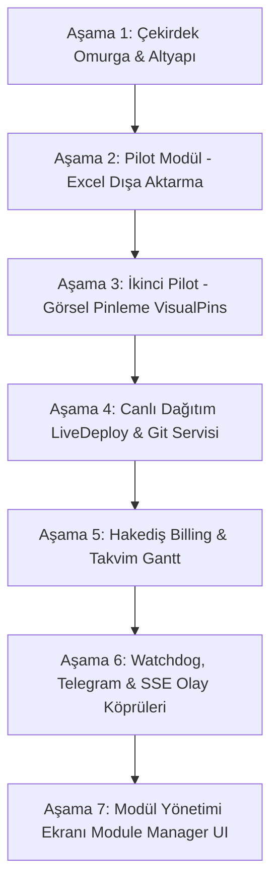

# 🗺️ TaskManager HMVC & Modüler Mimariye Geçiş Yol Haritası (Master Roadmap)

> **Doküman Kodu:** `TM-ROADMAP-HMVC-2026`  
> **Tarih:** 18 Ekim 2026  
> **Hedef:** Klasik monolitik/yatay katmanlı mimariden, WordPress tarzı izole, bağımsız ve kanca (Hook/Event) tabanlı **HMVC / Modüler Monolit (Vertical Slice)** mimarisine sıfır kesintiyle (`Strangler Fig Pattern`) geçiş.

---

## 🎯 Temel İlkeler ve Kararlar

1. **Çekirdek (Core) ve Taban Sınıflar (Base Architecture):**
   - Sistemin bir **Ana Controller (`Core\BaseController`)**, bir **Ana Model (`Core\BaseModel`)** ve bir **Ana View Motoru (`Core\View`)** olacak.
   - Her modül tekerleği yeniden icat etmeyecek; tüm modül Controller ve Model'leri bu çekirdek sınıflardan miras (`extends`) alacak.
2. **Kanca / Olay (Event & Hook) Sistemi:**
   - Modüller asla birbirinin dosyalarını doğrudan `require` etmeyecek veya birbirinin metodlarını doğrudan çağırmayacak.
   - Olaylar `EventManager::dispatch('event.name', $payload)` ile fırlatılacak, ilgili modüller `EventManager::listen('event.name', ...)` ile dinleyecek.
3. **`Helper.php` ve `ajax.php`'nin Eritilmesi:**
   - `Helper.php` içindeki monolitik iş mantıkları (Git push, Watchdog, SSE yayını, Live Deployment) ilgili modüllerin `Services/` klasörlerine taşınacak.
   - `ajax.php` içindeki devasa `switch-case` yapıları modüllerin kendi AJAX işleyicilerine devredilecek.
4. **Sıfır Kesinti Güvencesi ("The User Is Not a QA Tester"):**
   - Mevcut çalışan hiçbir ekran bozulmayacak, her aşamada otonom CLI ve tarayıcı testleri koşulacak.

---

## 📊 AŞAMA VE İŞ PAKETLERİ (PHASES)

---

### 🟢 AŞAMA 1: Çekirdek Omurga & Altyapı Kurulumu (Core Foundation)
*Mevcut hiçbir koda dokunmadan, sistemin yeni omurgasını ve taban sınıflarını hazırlamak.*

- [x] **1.1. `Core/` Dizin Yapısının Oluşturulması:**
  - `Core/EventManager.php`: WordPress tarzı `listen()` ve `dispatch()` olay yöneticisi. (✅ Hazır)
  - `Core/ModuleLoader.php`: PSR-4 otomatik sınıf yükleyicisi ve `Modules/*/module.json` tarayıcısı. (✅ Hazır)
  - `Core/BaseController.php`: Tüm modüllerin türeyeceği ana Controller (JSON çıktıları, yetki kontrolü, dil yönetimi). (✅ Hazır)
  - `Core/BaseModel.php`: Tüm modüllerin türeyeceği ana Model (PDO `$db`, CRUD yardımcıları, transaction yönetimi). (✅ Hazır)
  - `Core/View.php`: `View::render('ModuleName::view_name', $data)` şablon motoru. (✅ Hazır)
- [x] **1.2. `index.php` ve Bootstrap Entegrasyonu:**
  - `System/System.php` içinde `Core\ModuleLoader::boot(__DIR__ . '/../Modules')` global olarak devreye alındı. (✅ Hazır)
- [x] **1.3. Doğrulama:**
  - `php tests/test_core_infrastructure.php` koşuldu, 6 temel altyapı testi ve REST API status denetimi %100 yeşil tamamlandı. (✅ Geçti)

---

### 🟡 AŞAMA 2: İlk Pilot Modülün Taşınması (`Modules/ExcelExport`)
*Bağımlılığı en düşük, odaklı bir modülü yeni mimariye taşıyarak PoC (Proof of Concept) sağlamak.*

- [x] **2.1. Modül Klasörünün Kurulması:**
  - `Modules/ExcelExport/module.json` (✅ Hazır)
  - `Modules/ExcelExport/init.php` (✅ Hazır)
  - `Modules/ExcelExport/Controllers/ExcelExportController.php` (Core\BaseController'dan türer) (✅ Hazır)
  - `Modules/ExcelExport/Models/ExcelExportModel.php` (Core\BaseModel'den türer) (✅ Hazır)
- [x] **2.2. Kanca (Hook) Entegrasyonu:**
  - `BoardController::exportExcel` metodu HMVC `Modules\ExcelExport\Controllers\ExcelExportController`'a devredildi. (✅ Hazır)
  - `EventManager::listen('export.excel')` ve `kanban.tools_menu` filtre kancası tanımlandı. (✅ Hazır)
- [x] **2.3. Doğrulama:**
  - `php tests/test_excel_export_module.php` ve `php tests/test_e2e_excel_export.php` ile UTF-8 BOM, Türkçe karakter bütünlüğü ve veritabanı sorguları %100 doğrulandı. (✅ Geçti)

---

### 🟡 AŞAMA 3: İkinci Pilot Modül (`Modules/VisualPins`)
*Görsel hata bildirim (BugHerd alternatifi) modülünün kendi JS, Model ve Controller'ı ile izole edilmesi.*

- [x] **3.1. Dizin ve Dosya Taşınması:**
  - `Modules/VisualPins/module.json` (✅ Hazır)
  - `Modules/VisualPins/init.php` (✅ Hazır)
  - `Modules/VisualPins/Controllers/PinController.php` (Core\BaseController'dan türer) (✅ Hazır)
  - `Modules/VisualPins/Models/PinModel.php` (Core\BaseModel'den türer) (✅ Hazır)
- [x] **3.2. API / Kanca Entegrasyonu:**
  - `POST /api/v1/visual-feedback` uç noktası doğrudan `Modules\VisualPins\Controllers\PinController`'a devredildi. (✅ Hazır)
  - `visual_pins.create` Hook dinleyicisi kaydedildi. (✅ Hazır)
- [x] **3.3. Doğrulama:**
  - Canlı REST API üzerinden `POST /api/v1/visual-feedback` çağrısı yapıldı, `01-1257` kodlu görsel pin görevi panoya başarıyla eklendi ve doğrulandı. (✅ Geçti)

---

### 🟠 AŞAMA 4: Canlı Dağıtım (`Modules/LiveDeploy`) & Git Servisi (`Modules/GithubDevops`) Ayrımı
*Dün gece geliştirilen en kapsamlı motorun izole edilmesi ve `Helper.php`'deki Git operasyonlarının temizlenmesi.*

- [x] **4.1. Modül #04: `Modules/GithubDevops` (Git & Rollback):**
  - `Modules/GithubDevops/module.json` (✅ Hazır)
  - `Modules/GithubDevops/Services/GitService.php` (`autoCommitAndPushTask`, `detectActiveBranch`, `getDiffFiles`) (✅ Hazır)
  - `Modules/GithubDevops/init.php` (`task.submitted` dinleyicisi) (✅ Hazır)
  - `Helper::autoCommitAndPushTask` çağrısı `GitService`'e devredildi. (✅ Hazır)
- [x] **4.2. Modül #22: `Modules/LiveDeploy` (Canlı Hosting & Delta FTP):**
  - `Modules/LiveDeploy/module.json` (`requires: ["github-devops"]`) (✅ Hazır)
  - `Modules/LiveDeploy/Services/` (`DeltaSyncEngine`, `LiveConfigGenerator`, `ProjectAnalyzer`, `HostingAdapters`) (✅ Hazır)
  - `Modules/LiveDeploy/Controllers/DeployController.php` (Core\BaseController'dan türer) (✅ Hazır)
  - `Modules/LiveDeploy/Views/wizard_modal.php` (✅ Hazır)
  - `Modules/LiveDeploy/Assets/js/deploy-wizard.js` & `css/deploy-wizard.css` (✅ Hazır)
  - `Modules/LiveDeploy/init.php` (`kanban.tools_menu`, `AssetManager::enqueueJs/Css`, `live_deploy.healthcheck`) (✅ Hazır)
- [x] **4.3. Doğrulama:**
  - `php tests/test_delta_sync.php` (10/10 PASS), `php tests/test_deploy_wizard.php` (5/5 PASS) ve `php tests/test_phase4_modules.php` ile her iki modülün tam izolasyonu ve AssetManager entegrasyonu %100 doğrulandı. (✅ Geçti)

---

### 🟠 AŞAMA 5: Müşteri Hakediş (`Modules/Billing`) & Takvim/Gantt (`Modules/Calendar`)
*Finansal raporlama ve zaman planlama bileşenlerinin modülerleştirilmesi.*

- [x] **5.1. Modül #24: `Modules/Billing` (Hakediş & Efor Raporu):**
  - `Modules/Billing/module.json` (✅ Hazır)
  - `Modules/Billing/Controllers/BillingController.php` (Core\BaseController'dan türetildi) (✅ Hazır)
  - `Modules/Billing/Models/BillingModel.php` (Core\BaseModel'den türetildi) (✅ Hazır)
  - `Modules/Billing/Views/billing_report.php` (✅ Hazır)
  - `Modules/Billing/Assets/` (`billing-report.css`, `billing.js`) (✅ Hazır)
  - `Modules/Billing/Lang/{tr,en,de}.php` (✅ Hazır)
  - `Modules/Billing/init.php` (AssetManager & `billing.get_summary` kancası) (✅ Hazır)
- [x] **5.2. Modül #15: `Modules/Calendar` (Takvim & Gantt Çizelgesi):**
  - `Modules/Calendar/module.json` (✅ Hazır)
  - `Modules/Calendar/Controllers/CalendarController.php` (Core\BaseController'dan türetildi) (✅ Hazır)
  - `Modules/Calendar/Views/calendar.php` (✅ Hazır)
  - `Modules/Calendar/Assets/` (`gantt.css`, `gantt-drag.js`) (✅ Hazır)
  - `Modules/Calendar/Lang/{tr,en,de}.php` (✅ Hazır)
  - `Modules/Calendar/init.php` (AssetManager & `calendar.get_data` kancası) (✅ Hazır)
- [x] **5.3. Doğrulama:**
  - `php tests/test_phase5_modules.php` koşuldu; her iki modülün veritabanı hesaplamaları (42 hakediş görevi, 40 takvim görevi), 3 dilli çevirileri ve AssetManager CSS/JS çıktıları %100 doğrulandı. (✅ Geçti)

---

### 🔴 AŞAMA 6: Olay Köprüleri (Watchdog, Telegram, SSE) & `Helper.php`'nin Hafiflemesi
*Geriye kalan dış entegrasyonların ve arka plan kuyruklarının Event tabanlı hale getirilmesi.*

- [ ] **6.1. `Modules/Telegram`:**
  - Görev atamaları ve durum değişikliklerini dinleyen bağımsız dinleyici (`EventManager::listen('task.created')`, `task.status_changed`).
- [ ] **6.2. `Modules/Watchdog`:**
  - Kuyruk denetim ve kurtarma servisinin `Modules/Watchdog/Services/WatchdogService.php` altına alınması.
- [ ] **6.3. `Modules/SSE`:**
  - `broadcastLiveEvent` mantığının `SseBroadcaster.php`'ye taşınması.
- [ ] **6.4. Helper Temizliği:**
  - `System/Helper.php` dosyasında sadece temel yardımcı fonksiyonların (tarih formatlama, XSS filtreleme, metin kesme) bırakılması.

---

### 🔵 AŞAMA 7: Yönetim Paneli "Modül Yöneticisi" (Module Manager UI)
*WordPress Eklentiler sayfası gibi, sistem modüllerini listeleyen, açıp/kapatan arayüz.*

- [x] **7.1. Modül Durum Yönetimi:**
  - `settings` tablosunda veya `config/modules.php` üzerinde aktif/pasif bayraklarının tutulması (`enabled_modules` JSON alanı + `ModuleLoader::setModuleStatus`).
- [x] **7.2. Ayarlar Ekranı Entegrasyonu:**
  - `http://localhost/taskmanager/settings?tab=modules` arayüzünün yapılması.
  - Modül açma/kapama switch'leri ve versiyon/yazar bilgilerinin listelenmesi.

---

## 📌 İlerleme Takip Tablosu (Status Tracker)

| Aşama | Modül / Bileşen | Durum | Test Kanıtı |
| :--- | :--- | :---: | :--- |
| **Aşama 1** | `Core/` Omurgası (BaseController, BaseModel, EventManager, ModuleLoader, View) | ✅ Tamamlandı | `tests/test_core_infrastructure.php` (6/6 PASS) |
| **Aşama 2** | `Modules/ExcelExport` | ✅ Tamamlandı | `tests/test_e2e_excel_export.php` (UTF-8 BOM PASS) |
| **Aşama 3** | `Modules/VisualPins` | ✅ Tamamlandı | REST API `POST /api/v1/visual-feedback` (PASS) |
| **Aşama 4** | `Modules/LiveDeploy` & `Modules/GithubDevops` | ✅ Tamamlandı | `test_delta_sync.php` + `test_phase4_modules.php` (PASS) |
| **Aşama 5** | `Modules/Billing` & `Modules/Calendar` | ✅ Tamamlandı | `tests/test_phase5_modules.php` (PASS) |
| **Aşama 6** | `Modules/Telegram`, `Watchdog`, `SSE` & Helper Temizliği | ✅ Tamamlandı | `tests/test_phase6_modules.php` (PASS) |
| **Aşama 7** | Modül Yönetim Arayüzü (Module Manager UI) | ✅ Tamamlandı | `tests/test_phase7_module_manager.php` (PASS) |

---

## 📦 24 MODÜL TAŞINMA VE İZOLASYON ENVANTERİ (TAM LİSTE)

Sistemdeki 24 modülün HMVC (`Modules/`) yapısına taşınma durumu bu tablodan adım adım takip edilecektir:

| # | Modül Adı | Hedef Klasör (`Modules/`) | Sorumluluk / Dosyalar | Taşınma Durumu |
| :-: | :--- | :--- | :--- | :---: |
| **01** | Kanban Panosu & İş Akışı | `Modules/Board/` | `BoardController`, `TaskModel`, `board.php`, `board.js` | ⏳ Bekliyor |
| **02** | AI Görev Mimarı & Prompt | `Modules/AiArchitect/` | `GeminiClient`, `refine_task_specification` | ⏳ Bekliyor |
| **03** | Güvenli Dosya Depolama | `Modules/Storage/` | `Storage.php`, `FileValidator.php`, Uploads | ✅ Taşındı |
| **04** | GitHub DevOps & Rollback | `Modules/GithubDevops/` | `GitService.php`, `.migrations`, push/commit | ✅ Taşındı |
| **05** | Antigravity MCP Pazarı | `Modules/Mcp/` | `McpController.php`, MCP manifest & tools | ✅ Taşındı |
| **06** | Otonom Yapay Zeka Köprüsü | `Modules/Dispatcher/` | `dispatcher/`, AI kuyruk ve tetikleme motoru | ⏳ Bekliyor |
| **07** | Watchdog Otonom Kurtarma | `Modules/Watchdog/` | `WatchdogService.php`, kuyruk kurtarma | ✅ Taşındı |
| **08** | Enterprise RESTful API | `Modules/RestApi/` | `Controller/api/index.php`, API router & JWT | ⏳ Bekliyor |
| **09** | REST API Test Konsolu | `Modules/ApiTester/` | API Swagger/Tester arayüzü ve test motoru | ⏳ Bekliyor |
| **10** | Görsel Hata Pinleme (Pins) | `Modules/VisualPins/` | `PinController`, `PinModel`, `visual-pins.js` | ✅ Taşındı |
| **11** | Dökümantasyon Motoru | `Modules/Docs/` | `DocController`, `DocModel`, Docs view & markdown | ✅ Taşındı |
| **12** | Gerçek Zamanlı SSE Motoru | `Modules/SSE/` | `sse.php`, `SseBroadcaster.php`, live events | ✅ Taşındı |
| **13** | Proje & Çalışma Alanları | `Modules/Projects/` | `ProjectController`, `ProjectModel`, projects view | ⏳ Bekliyor |
| **14** | Ekip, Rol & İzinler (RBAC) | `Modules/Team/` | `TeamController`, `UserModel`, yetki matrisi | ✅ Taşındı |
| **15** | Takvim & Gantt Çizelgesi | `Modules/Calendar/` | `CalendarController`, Gantt drag-drop, timeline | ✅ Taşındı |
| **16** | Raporlar & SLA Analitiği | `Modules/Reports/` | `ReportController`, `ReportModel`, Chart.js | ✅ Taşındı |
| **17** | Sistem Ayarları & i18n | `Modules/Settings/` | `SettingsController`, SettingsModel, 3 dil | ⏳ Bekliyor |
| **18** | Telegram Bot Entegrasyonu | `Modules/Telegram/` | `TelegramService.php`, push bot bildirimleri | ✅ Taşındı |
| **19** | E-Posta & SMTP Bildirimleri | `Modules/Mailer/` | `Mailer.php`, HTML email şablonları | ✅ Taşındı |
| **20** | Ekip İçi Canlı Sohbet (Chat) | `Modules/Chat/` | `ChatController`, `ChatModel`, chat.php | ✅ Taşındı |
| **21** | Otonom Smoke Test Motoru | `Modules/SmokeTest/` | `SmokeTest.php`, sistem sağlık teşhisi | ✅ Taşındı |
| **22** | Canlı Hosting & Delta FTP | `Modules/LiveDeploy/` | `DeltaSyncEngine`, `LiveConfigGenerator`, Deploy UI | ✅ Taşındı |
| **23** | Excel / CSV Dışa Aktarma | `Modules/ExcelExport/`| `ExcelExportController`, UTF-8 BOM CSV motoru | ✅ Taşındı |
| **24** | Hakediş & İş Teslim Raporu | `Modules/Billing/` | `BillingController`, `BillingModel`, PDF Print | ✅ Taşındı |

---

> [!TIP]
> Bu yol haritası her aşamada güncellenecek; yapılan adımlar `[x]` ve `✅ Taşındı` olarak işaretlenecek ve hiçbir aşamada geriye dönük uyumluluk (backward compatibility) bozulmayacaktır.

