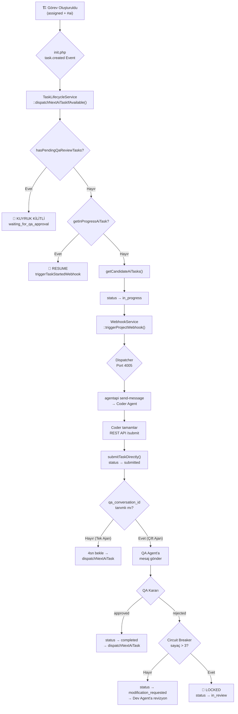

# 🔍 TaskManager Otonom AI Dispatch Sistemi — Tarafsız Audit Raporu

**Tarih:** 2026-10-21  
**Kapsam:** Dispatcher, TaskLifecycleService, Watchdog, WebhookService, REST API Workflow  
**Yaklaşım:** Mimari → Veri Akışı → Hata Noktaları → Öneriler

---

## 📐 Mimari Genel Bakış



---

## ✅ İyi Çalışan Yönler

| # | Güçlü Yön | Detay |
|---|-----------|-------|
| 1 | **Dual-Agent Mimarisi** | Dev → QA → Approve/Reject döngüsü iyi tasarlanmış |
| 2 | **Circuit Breaker** | 3 revizyon limitinden sonra `in_review` ile sonsuz döngüyü kırıyor |
| 3 | **Watchdog Kurtarma** | Her 20sn'de bir stale görevleri tespit edip kuyruk denetimi yapıyor |
| 4 | **Anti-Spam Mekanizması** | Aynı görev + aynı pencere + 20dk içinde tekrar tetiklemeyi engelliyor |
| 5 | **Fallback Zincirleri** | Webhook başarısızsa → `dispatchDirect()`, conversation bulunamazsa → `new-conversation` |
| 6 | **Pull Agent Modu** | Canlı sunucu için webhook yerine polling modeli sunması |
| 7 | **Git Auto-Commit** | Görev tesliminde otomatik commit & push + rollback SQL |
| 8 | **SSE Canlı Yayın** | Board UI'ın gerçek zamanlı güncellenmesi |

---

## 🐛 Kritik Sorunlar & Düzeltilmesi Gerekenler

### 🔴 KRİTİK-1: QA Kilidi Tüm Projeyi Tıkıyor (Az Önce Yaşadığınız Bug)

**Dosya:** [TaskLifecycleService.php:288-295](file:///c:/wamp64/www/taskmanager/Modules/Board/Services/TaskLifecycleService.php#L288-L295)

**Sorun:** `hasPendingQaReviewTasks()` kontrol ediyor ama QA ajanı o anda çalışmıyorsa veya QA penceresi kapalıysa, kuyruk **sonsuza kadar kilitli kalıyor**. Hiçbir zaman aşımı (timeout) yok.

```php
// Şu anki kod — timeout yok!
if ($taskModel->hasPendingQaReviewTasks($projectId)) {
    return ['status' => 'waiting_for_qa_approval']; // 🛑 SONSUZA DEK KİLİT
}
```

**Çözüm Önerisi:**
- QA bekleyen görevlerin `submitted` tarihinden itibaren **30-60 dakika** geçmişse kilidi otomatik açmak
- Veya Watchdog'a "QA timeout recovery" mantığı eklemek

---

### 🔴 KRİTİK-2: `hasPendingQaReviewTasks` Çok Geniş — AI OLMAYAN Görevler de Kuyruğu Kilitliyor

**Dosya:** [TaskModel.php:1009-1016](file:///c:/wamp64/www/taskmanager/Modules/Board/Models/TaskModel.php#L1009-L1016)

**Sorun:** Sorgu sadece `project_id` ve `status IN ('submitted','under_review')` filtresi kullanıyor. Yani **kullanıcının manuel olarak submitted/under_review yaptığı** veya **insan görevi** olan görevler de kuyruğu kilitliyor.

```sql
-- Şu anki sorgu — AI/insan ayrımı yok!
SELECT id FROM tasks WHERE project_id = ? AND status IN ('submitted', 'under_review') LIMIT 1
```

**Çözüm:** Sadece AI etiketli görevleri filtrelemek:
```sql
SELECT id FROM tasks WHERE project_id = ? 
  AND status IN ('submitted', 'under_review') 
  AND (LOWER(tags) LIKE '%ai%' OR LOWER(tags) LIKE '%otonom%' OR ...)
  LIMIT 1
```

---

### 🟠 ORTA-1: Dispatcher'da `task.submitted` Tek Ajan Modundaki 4sn Bekleme Fragile

**Dosya:** [dispatcher.py:400-407](file:///c:/wamp64/www/taskmanager/Modules/Dispatcher/Bin/dispatcher.py#L400-L407)

**Sorun:** Tek ajan modunda `time.sleep(4)` ile sabit bekleme yapılıyor. Eğer PHP tarafında `submitTaskDirectly()` hala çalışıyorsa (büyük git push, DB migration vb.), 4 saniye yetersiz kalır ve sıradaki görev tetiklenirken hala eski görevin teslim süreci devam ediyor olabilir.

**Çözüm:** `dispatchNextAiTaskIfAvailable` çağrısından önce görevin gerçekten `submitted` statüsüne ulaştığını kontrol etmek.

---

### 🟠 ORTA-2: DispatcherService.php'de `$discoveredCid` Tanımsız Olabilir

**Dosya:** [DispatcherService.php:575](file:///c:/wamp64/www/taskmanager/Modules/Dispatcher/Services/DispatcherService.php#L575)

**Sorun:** `dispatchDirect()` içinde `task.submitted` event'inde `$discoveredCid` hiç atanmadan döndürülüyor (L485-498 arasında QA branching'de `$discoveredCid` set edilmiyor ama L575'te return array'inde kullanılıyor).

```php
if ($event === 'task.submitted') {
    $targetCid = trim($project->qa_conversation_id ?? '');
    // $discoveredCid hiç atanmadı!
    ...
}
// ...
return [
    'discovered_cid' => $discoveredCid, // ⚠️ Undefined variable
];
```

---

### 🟠 ORTA-3: Watchdog `runInspection()` ile `getHealthReport()` Çelişkili Davranış

**Dosya:** [WatchdogService.php](file:///c:/wamp64/www/taskmanager/Modules/Watchdog/Services/WatchdogService.php)

**Sorun:** İki farklı kurtarma stratejisi var:
1. `runInspection()` → 20dk'dan uzun süredir `in_progress` ise **resume webhook** gönderir (görevi assigned'a çekmez)
2. `getHealthReport()` → 25dk'dan uzun süredir `in_progress` ise **assigned'a geri çeker**

Bu iki metot birbiriyle yarışabilir:
- 20dk'da Watchdog resume gönderir
- 25dk'da `getHealthReport` çağrılırsa görevi `assigned`'a çeker
- O sırada ajan devam ediyorsa data kaybı yaşanabilir

**Çözüm:** Tek bir strateji belirlemek: ya resume ya reset. İkisi birden olmamalı.

---

### 🟠 ORTA-4: `modification_requested` Durumunda Görev Tetikleme Eksik

**Dosya:** [dispatcher.py:478](file:///c:/wamp64/www/taskmanager/Modules/Dispatcher/Bin/dispatcher.py#L478)

**Sorun:** Dispatcher'da `task.revision_requested` olayı geldiğinde mesaj gönderiliyor, ancak `TaskLifecycleService::handleQaReviewDecision()` görevin durumunu `modification_requested` yapıyor. Bu durumda görev ne `in_progress` ne `assigned` — çünkü ajan mesajı aldıktan sonra görevi manuel olarak `in_progress` yapması gerekiyor ama bunu yapan bir mekanizma yok.

**Çözüm:** `handleQaReviewDecision` rejected kararından sonra görevin durumunu `modification_requested` yerine `in_progress` yapmak, ya da revision webhook göndermeden önce durumu `in_progress`'e çekmek.

---

### 🟡 DÜŞÜK-1: `init.php` task.status_changed Olayı Gereksiz Çift Tetikleme Riski

**Dosya:** [init.php:19-26](file:///c:/wamp64/www/taskmanager/Modules/Dispatcher/init.php#L19-L26)

**Sorun:** `task.status_changed` event'inde `new_status === 'in_progress'` olduğunda `triggerTaskStartedWebhook` çağrılıyor. Ama `dispatchNextAiTaskIfAvailable()` de zaten aynı webhook'u çağırıyor. Dolayısıyla kullanıcı Board UI'dan bir görevi sürükleyip `in_progress`'e attığında hem event hook hem de kuyruk tetiklemesi aynı anda çalışabilir.

**Etki:** Aynı görev için iki kez mesaj gönderilme riski.

---

### 🟡 DÜŞÜK-2: Dispatcher Log Dosyası 1.5 MB ve Büyüyor

**Dosya:** [dispatcher.log](file:///c:/wamp64/www/taskmanager/Modules/Dispatcher/Bin/dispatcher.log) — 1,553,655 bytes

**Sorun:** Log rotasyonu yok. Süresiz büyüyor. Dolu diskte dispatcher çökebilir.

**Çözüm:** Basit bir boyut kontrolü ekleyip, 5MB'ı geçtiğinde truncate etmek.

---

### 🟡 DÜŞÜK-3: Hardcoded Yollar (`AGENTAPI_EXE`, `ANTIGRAVITY_CONV_DIR`, Python yolu)

**Dosya:** [dispatcher.py:102-103](file:///c:/wamp64/www/taskmanager/Modules/Dispatcher/Bin/dispatcher.py#L102-L103), [DispatcherService.php:55](file:///c:/wamp64/www/taskmanager/Modules/Dispatcher/Services/DispatcherService.php#L55)

```python
AGENTAPI_EXE = r"c:\Users\DELL\AppData\Local\Programs\..."
ANTIGRAVITY_CONV_DIR = r"C:\Users\DELL\.gemini\antigravity-ide\conversations"
```

**Sorun:** Başka bir makinede veya kullanıcıda çalışmaz. Taşınabilirlik sıfır.

**Çözüm:** Ortam değişkeni (`ANTIGRAVITY_HOME`) veya `%USERPROFILE%` ile dinamik hale getirmek.

---

### 🟡 DÜŞÜK-4: WebhookService cURL Timeout Çok Kısa (2 saniye)

**Dosya:** [WebhookService.php:79](file:///c:/wamp64/www/taskmanager/Modules/RestApi/Services/WebhookService.php#L79)

```php
curl_setopt($ch, CURLOPT_TIMEOUT, 2);
```

**Sorun:** Dispatcher yoğun yük altında veya ağ latansı yüksekse 2 saniye yetersiz. Timeout aşıldığında webhook başarısız sayılır ve fallback (`dispatchDirect`) devreye girer — bu da HTTP isteğini bloklar.

---

## 📊 Öncelik Matrisi

| Öncelik | Sorun | Etki | Çözüm Zorluğu |
|---------|-------|------|----------------|
| 🔴 P0 | QA Kilidi Timeout Yok | Kuyruk sonsuza kadar tıkanıyor | Kolay (15 dk) |
| 🔴 P0 | hasPendingQa AI filtresiz | İnsan görevleri de kuyruğu kilitliyor | Kolay (10 dk) |
| 🟠 P1 | modification_requested → ajan triggerı eksik | QA rejected sonrası ajan çalışamıyor | Orta (30 dk) |
| 🟠 P1 | `$discoveredCid` undefined | PHP Warning/Notice | Kolay (5 dk) |
| 🟠 P1 | Watchdog çelişkili stratejiler | Veri kaybı riski | Orta (20 dk) |
| 🟠 P2 | 4sn sleep fragile | Race condition | Orta (20 dk) |
| 🟡 P3 | Çift tetikleme riski | Duplicate mesaj | Kolay (10 dk) |
| 🟡 P3 | Log rotasyonu yok | Disk dolması | Kolay (10 dk) |
| 🟡 P3 | Hardcoded yollar | Taşınabilirlik | Orta (30 dk) |
| 🟡 P3 | cURL timeout 2sn | Gereksiz fallback | Kolay (5 dk) |

---

## 🎯 Genel Değerlendirme

> **Not:** Bu sistem genel mimari olarak **iyi düşünülmüş ve güçlü**. Dual-agent Dev/QA döngüsü, circuit breaker, watchdog kurtarma, SSE canlı yayın, git auto-commit gibi özellikler profesyonel seviyede. Ancak **edge case'ler** (QA timeout, insan görevleri filtreleme, state transition boşlukları) tam kapatılmamış ve bu tür "kuyruk tıkanması" sorunlarına yol açıyor.

**En acil 2 düzeltme:**
1. `hasPendingQaReviewTasks` → AI tag filtresi ekle
2. QA timeout mekanizması ekle (30-60dk sonra kilidi aç)
